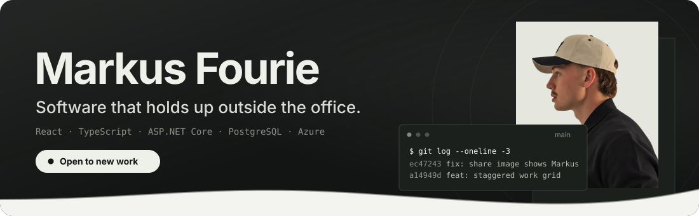

  

  

  
  &nbsp;&nbsp;
  
  &nbsp;&nbsp;
  
  &nbsp;&nbsp;
  

  

##  Now

Full-stack software developer at Katanga Contracting Services (KCS) / Rimitso, 2025 to present. The Resource Management System is live in production, and I'm open to new work and new experiences.

BSc Computer and Information Sciences, **Cum Laude**, Varsity College (now Emeris), Pretoria, completed December 2025. Varsity College Top Achiever 2025 and [Golden Key](https://golden-key-international-honou.verified.cv/en/verify/20892159851455) member.

  

##  Things I've shipped

<table>
  <tr>
    <td width="50%" valign="top">
      <h3>Resource Management System</h3>
      
For Katanga Contracting Services, since 2025. Sites, assets, teams, and shift transactions, with an approval step so unchecked numbers never reach a report. <strong>388 assets</strong>, <strong>46 users</strong>. Private: <a href="mailto:fourie.markus@outlook.com?subject=Walkthrough%3A%20Resource%20Management%20System">ask me for a walkthrough</a>.

      

        <code>React</code>
        <code>ASP.NET Core</code>
        <code>EF Core</code>
        <code>PostgreSQL</code>
        <code>SignalR</code>
        <code>Azure</code>
      

    </td>
    <td width="50%" valign="top">
      <h3>Afrisist</h3>
      
Fleet alarm desk, 2025. Operators see each alarm as it lands, own it, and follow it through. A limited engagement I handed over in October 2025. Private.

      

        <code>React</code>
        <code>Node.js</code>
        <code>PostgreSQL</code>
        <code>WebSocket</code>
        <code>Leaflet</code>
        <code>Azure</code>
      

    </td>
  </tr>
  <tr>
    <td width="50%" valign="top">
      <h3><a href="https://www.eridgerda.org.uk">Eridge RDA</a></h3>
      
UK charity site and CMS, 2024. A public site for a riding charity, with a CMS its volunteers keep current themselves.

      

        <code>React</code>
        <code>Vite</code>
        <code>Tailwind CSS</code>
        <code>Supabase</code>
        <code>Vercel</code>
      

    </td>
    <td width="50%" valign="top">
      <h3><a href="https://skillance.co.za">Skillance</a></h3>
      
Freelance marketplace for South Africa, co-built with <a href="https://www.linkedin.com/in/kyle-nel-026742193/">Kyle Nel</a>. Verified freelancers, with payment held until the client approves the work. Ongoing web and mobile app.

      

        <code>Flutter</code>
        <code>React</code>
        <code>Fastify</code>
        <code>PostgreSQL</code>
      

    </td>
  </tr>
  <tr>
    <td width="50%" valign="top">
      <h3>C-Flow</h3>
      
An internal system I build at Rimitso, installable as a PWA. Private: <a href="mailto:fourie.markus@outlook.com?subject=Walkthrough%3A%20C-Flow">ask me for a walkthrough</a>.

      

        <code>React</code>
        <code>PWA</code>
        <code>Tailwind CSS</code>
        <code>Azure</code>
      

    </td>
    <td width="50%" valign="top">
      <h3>Home lab</h3>
      
An HP Victus 15 running Plex and local models (Gemma, Qwen) on Ollama. I try things here before a client sees them.

      

        <code>Linux</code>
        <code>Plex</code>
        <code>Ollama</code>
      

    </td>
  </tr>
</table>

  

##  What I work in

My day to day is React and TypeScript at the front, and ASP.NET Core or Node with Postgres behind it. Cloud came once I had something worth hosting, and mobile with Flutter, which I'm building on Skillance.

- **Front end and web:** HTML, CSS, JavaScript, TypeScript, React, Tailwind CSS, Next.js, GSAP
- **Back end and data:** Node.js / Express, C#, ASP.NET Core, EF Core, SQL, PostgreSQL, MS SQL, MongoDB, Supabase, REST / OpenAPI, Python
- **Cloud and ops:** Linux, Docker, Nginx, GitHub Actions, Azure, Cloudflare (Turnstile, CDN, proxy, tunnels)
- **Mobile:** Flutter, with iOS and Android experiments
- **Learning now:** Three.js, Go

  
  
  
  
  
  
  
  
  
  
  
  

  

##  Off the clock

I ride: mostly cross-country marathons and long endurance days. In 2024 I rode the [Trans Baviaans](https://transbaviaans.co.za/), the 24-hour mountain bike marathon, and this year I rode the full Ford Trailseeker series.

  

##  Let's talk

Building something that has to work in the real world, or hiring someone who enjoys that kind of problem? Email me.

- Site: [markusfourie.dev](https://markusfourie.dev)
- Email: [fourie.markus@outlook.com](mailto:fourie.markus@outlook.com)
- LinkedIn: [markus-fourie](https://www.linkedin.com/in/markus-fourie/)
